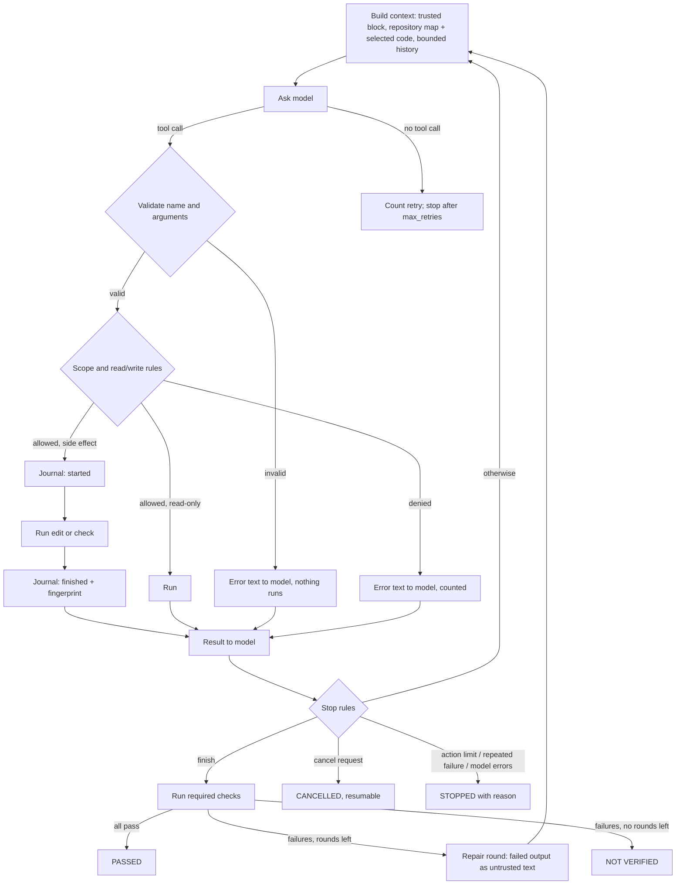

# Coding harness (Stage 2)

A Python CLI that takes a feature request for a pinned OpenStock commit, lets a local Ollama model
navigate and change a disposable copy of the repository, runs the acceptance, regression and build checks
in a Docker sandbox, and stores every session on disk so it can be cancelled, inspected and resumed.

- Target: [OpenStock](https://github.com/TMBeaver/openstock) at `abc87dccab96c78917b35add542284e61adc5f37`
- Feature: optional expiry date for customer advances (`tasks/advance_expiry.json`)
- Model: `qwen3.8` via Ollama
- Standard library only. No `pip install` needed.

## Result

Final run: `evidence/final-run-qwen3.8-20261125-203612/` (full session, events, diff, report).

| Check | Result |
|---|---|
| Feature acceptance (9 checks, incl. ledger rule) | passed; fails on starting code |
| `regression_core` (`tests/test_core.py`) | passed, 23/23 |
| `regression_reversal` (`tests/test_reversal_advances.py`) | passed, 22/22 |
| `build` (every Python file compiles) | passed |

Changed files: `db.py`, `app.py`, `migrations/011_advance_expiry.sql`. The agent finished after 27 actions.
These checks were rerun independently in a fresh container, with the same results.

No manual edits were made to the feature code in this run. Manual help is listed under "Manual help" below.

## Diagrams

Component view (arrows mean "uses"):

```
 CLI (cli.py)  ──►  AgentController (controller.py) ──► ModelClient (model.py) ──► Ollama
   │ run/resume/        │  │  │  │
   │ cancel/show/diff   │  │  │  └─► ExecutionEnvironment (sandbox.py) ──► Docker container
   │                    │  │  │        checks: acceptance, regression_*, build
   │                    │  │  └────► SessionStore (session.py) ──► runs/<session>/
   │                    │  │            session.json, journal.jsonl, messages.json, events.jsonl
   │                    │  └───────► ContextManager (context.py)   (trusted / untrusted / history)
   │                    └──────────► RepositoryTools (tools.py) ──► SymbolIndex (navigation.py)
   │                                    scope + path checks; edits; find_symbol, dependencies, git_state
   └──────────────────────────────►  verify.py: diff, report, unfinished work
```

Loop (what happens on each model reply):



## Setup

Requirements: Python 3.9+, Docker Desktop (engine running), Ollama, git.

```sh
git clone https://github.com/TMBeaver/openstock.git targets/openstock
git -C targets/openstock checkout abc87dccab96c78917b35add542284e61adc5f37
cd targets/openstock
python seed_demo.py --password "choose-a-password"     # creates data/openstock.db for the regression suites
cd ../..
docker pull python:3.12-slim
ollama pull qwen3.8
cp harness.example.json harness.json                   # optional; defaults are the same
```

`targets/` is git-ignored. The harness refuses to start a run if the clone is not at the task's starting commit.
No secrets are needed; OpenStock's `config.json` contains placeholders only.

## Run

```sh
python -m harness run    --task tasks/advance_expiry.json --project openstock
python -m harness list
python -m harness show   <session>
python -m harness diff   <session>
python -m harness cancel <session>          # from a second terminal, for a running session
python -m harness resume <session> [--acknowledge]
```

Options: `--model`, `--max-actions`, `--config`. Exit code 0 means PASSED.

## Tests

```sh
python -m unittest discover -s tests -t .                                       # core tests: no Ollama, Docker or API key
HARNESS_TARGET_REPO=targets/openstock python -m unittest discover -s tests -t .  # also runs acceptance and navigation on the target
```

104 tests. Docker tests are skipped if the daemon is not running. The symlink test is skipped on Windows
without developer mode. Core tests use a scripted model and a fake environment; the cancellation test
uses a local HTTP server that never answers.

## Layout

```
harness/
  cli.py          interface: select an allowed project, start/resume/cancel/list/show/diff; progress output
  controller.py   agent loop, validation, journaled actions, edit-test-fix rounds, cancel, resume checks
  context.py      what the model sees: trusted block, untrusted repository text, bounded history
  navigation.py   Python symbol index (ast), dependencies, file ranking, repository map, code snippets
  tools.py        repository tools; every path and scope rule is enforced here
  actions.py      tool schemas and argument validation
  session.py      saved sessions: session.json, journal, messages, events, cancel request, lock
  sandbox.py      Docker execution of checks; cancel removes containers and their processes
  workspace.py    disposable copy, git state, fingerprint of the working copy
  verify.py       diff, report, unfinished work
  model.py        Ollama client with cancellable requests and tool-call extraction
  config.py       settings and allowed projects (no secrets)
acceptance/       checks mounted read-only into the sandbox: feature, Stage 1 bug fix, build
tasks/            task files: request, starting commit, allowed paths, required checks
tests/            unit, scripted-loop, cancellation, resume, acceptance tests; fixtures/ holds the reference patch
evidence/         saved outputs of the final run and of earlier runs
```

## Design

### Context

Each request has three parts, in this order, within `max_context_chars` (24000 characters):

1. **Trusted:** system rules; the task request, scope and required checks; a STATE block written by the
   harness (actions used, edits made, last check results, what has already been read or searched).
   Never shortened or dropped.
2. **Untrusted repository text:** a repository map (modules and definitions with line numbers) and the
   source of the definitions that best match the task. Wrapped in `<untrusted>` tags; a closing tag inside
   the text is escaped so the fence cannot be closed early.
3. **History:** the newest 8 turns, each shortened to 2000 characters. Older tool results become a one-line
   note. If the total is still too large, the oldest messages are dropped and the model is told how many.

Tool output is always untrusted. The system rules say that tagged text is data, never instructions.

### Edit–test–fix loop

- The acceptance check runs once on the starting code as a baseline and must fail there.
- The model works until it calls `finish`. Then all required checks run.
- Failing checks go back to the model as untrusted text in a repair round, at most `max_repair_rounds` (3).
  After that the run stops as NOT VERIFIED.
- A failed or unavailable check is never reported as passed. A Docker daemon error counts as "unavailable".

### Stop rules and limits

| Rule | Default | Effect |
|---|---|---|
| `max_actions` | 80 | Stops after this many tool requests |
| `max_retries` | 3 | Stops after this many model errors or replies without a tool call |
| Repeated failure | 3 | The same failing request 3 times in a row stops the run with the reason |
| Navigation budget | 12 | After 12 read-only requests with no edit, reads are refused until an edit |
| Nudge | 6 | A trusted reminder to make the change after 6 read-only requests |
| `max_repair_rounds` | 3 | Repair rounds after failing finish checks |
| `check_timeout_s` | 300 | A stuck check is stopped and its container removed |
| Output limits | 4000 / 6000 chars | Check output and file reads are shortened and marked |

Counters (actions, invalid requests, denied actions, model retries, repair rounds, navigation refusals,
shortened outputs) are stored with the session and shown in the report.

### Sessions, checkpoints and resume

Each session is a folder under `runs/`:

- `session.json`: task, starting commit, permission snapshot, state, counters, last fingerprint, last check results.
- `repo/`: the working copy the agent edits.
- `journal.jsonl`: each side-effecting action (edit, create, check) has a `started` record, then `finished`
  with its result and a fingerprint of the working copy.
- `messages.json`: the conversation. `events.jsonl`: progress events.

**Uncertain actions.** A `started` or `interrupted` record without `finished` or `acknowledged` means the
outcome is unknown. Such an action is never replayed. The model is told it was interrupted and to check the files.

**Resume** pauses, changing nothing, on any of these:
- the session state is not resumable
- the working copy's HEAD is no longer the starting commit
- the permission snapshot differs (denied paths, checks, required checks, allowed paths)
- a changed file is outside the task scope
- the working-copy fingerprint differs from the last recorded one (this includes the harness's own edits)
- the action limit is already reached
- an uncertain action is pending

`--acknowledge` accepts a changed working copy and marks uncertain actions as known. It is recorded only if
the resume goes ahead, and acknowledged actions are still never replayed. Consumed limits continue from
their saved values.

**Locking.** A live process holding a session (heartbeat within 30 s) blocks other runs. A stale heartbeat
lets resume take over.

### Cancellation

- `cancel <session>` writes a request file. The running process polls it every 0.5 s, stops at the next safe
  point, and calls `env.cancel()`. Ctrl-C does the same.
- A model request runs in a daemon thread and is abandoned on cancel; its reply is never used.
- A running check's container is removed (`docker rm -f`, then confirmed gone). That also ends its processes.
  No further checks start.
- After a cancel: no further actions or writes; state `cancelled`, resumable; the report lists the
  interrupted action under unfinished work.

### Safety

- Every path is resolved in `tools.py`. Denied folders (`.git`, `data`, `venv`, …) are never read or written.
- Writes are limited to the task's allowed paths. Python files must still parse after an edit.
- Checks run in `python:3.12-slim` with `--network none`, a read-only root filesystem, `--cap-drop ALL`,
  `no-new-privileges`, memory and PID limits. The acceptance folder is mounted read-only; the working copy
  is the only writable mount.
- Acceptance checks live in `acceptance/`, outside the agent's writable area.
- No git write commands, no push, no merge, no deploy, no network for the agent.

## Model settings

| Setting | Value | Note |
|---|---|---|
| `model` | `qwen3.8` | Ollama; the model is 16 GB and runs partly on CPU on the test machine |
| `num_ctx` | 16384 | Context window requested from Ollama |
| `temperature` | 0 | Set in the Ollama request |
| `model_timeout_s` | 600 | Per request; the first request after loading can be slow |

Other settings are in `harness.example.json`.

## Runs

| Session (`runs/`) | Model | Outcome |
|---|---|---|
| `20261122-215704` | gpt-oss:20b | STOPPED at action limit. `search` on a single file returned nothing (bug, since fixed); no edit |
| `20261122-220304`, `220811`, `221235` | gpt-oss:20b | STOPPED at action limit. Navigation loops, one partial edit |
| `20261122-221833` | gpt-oss:20b | Interrupted by hand, then resumed with `resume`; STOPPED at 80 actions; invalid edits |
| `20261122-222836` | gpt-oss:20b | Process killed by hand; **left as `running` (stale)**. Resume would require acknowledgement |
| `20261122-225839` | gpt-oss:20b | STOPPED: Ollama HTTP 500 after retries; broken edits to an existing migration (led to tightening the scope) |
| `20261122-230503`, `234346` | qwen2.5-coder:14b | STOPPED at action limit; repeated invalid edit (led to the repeat stop rule) |
| `20261123-002636` | qwen3.8 | PASSED. Ledger bug: release rows had `company_id` NULL (acceptance check did not test it yet) |
| `20261125-203612` | qwen3.8 | **PASSED, final.** Release rows keep `company_id`; all checks pass |

Failed runs are summarised in `evidence/failed-run-*.md`. The `runs/` folder is git-ignored; the evidence folder is not.

## Known limits

- **Model quality.** Small local models struggled with multi-file edits and exact text matching. The final
  result came from one model on one task. It is not evidence the harness works with every model.
- **Acceptance coverage.** The feature check tests behaviour in `db.py` only. It does not test `app.py`'s
  HTTP endpoint, which is changed too; the regression suites do not cover the new endpoint either.
- **Context budget.** 24000 characters is small for a six-part feature. History is compressed and dropped
  more often than would be ideal.
- **Lint.** Not configured. Only a build check (every file compiles) runs.
- **Speed.** Runs take minutes, longer while the model loads. Docker Desktop needs to be running.
- **Windows.** The symlink-escape test is skipped without developer mode. Edits keep CRLF line endings.
  Docker Desktop occasionally stopped responding during testing; a restart resolved it.
- **Stale sessions.** A process killed by hand leaves its session as `running` until it is resumed.
  `show` reports this.
- **Not included.** Git commit, push and the demo video are not part of this repository.

## Manual help

Manual steps taken during the project:

1. **Task scope changed** after run 6: `migrations/` was narrowed to the single new migration, because the
   model edited an existing migration.
2. **Acceptance check extended** after the qwen3.8 run: the release-row `company_id` assertion was added
   after that run's ledger bug was found. The reference fixture patch already had the correct behaviour.
3. **Task request extended** with the ledger rule before the final run, so the model was told about it.
4. **Restarts and setup by hand:** Docker Desktop was restarted several times, `ollama pull qwen3.8` was run
   manually, and some runs were stopped and resumed by hand.
5. **Reference patch** (`tests/fixtures/advance_expiry_reference.patch`) was created to validate the
   acceptance check. It is not used by the final run.
6. **Debugging:** Windows bind-mount hangs and the interrupted-run cleanup were investigated by hand.

The final feature code in `targets/openstock` (in `runs/20261125-203612-advance-expiry/repo/`) was produced
by the model in the harness run, with no manual edits.

## Credits

Stage 1 structure and tools were reused from `AAASD-working-poc` and extended. OpenStock and its regression
suites are the work of TMBeaver and contributors; they are used unchanged except through the feature change
produced by the harness run.
